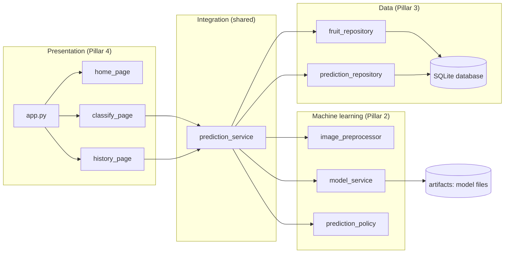
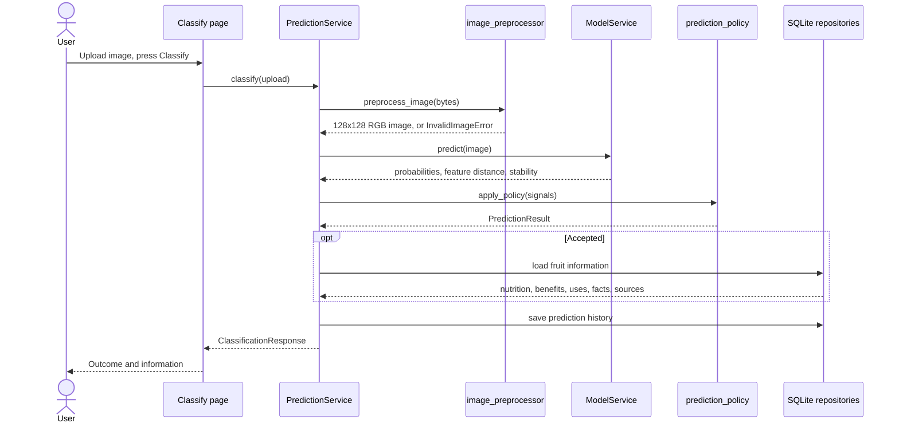
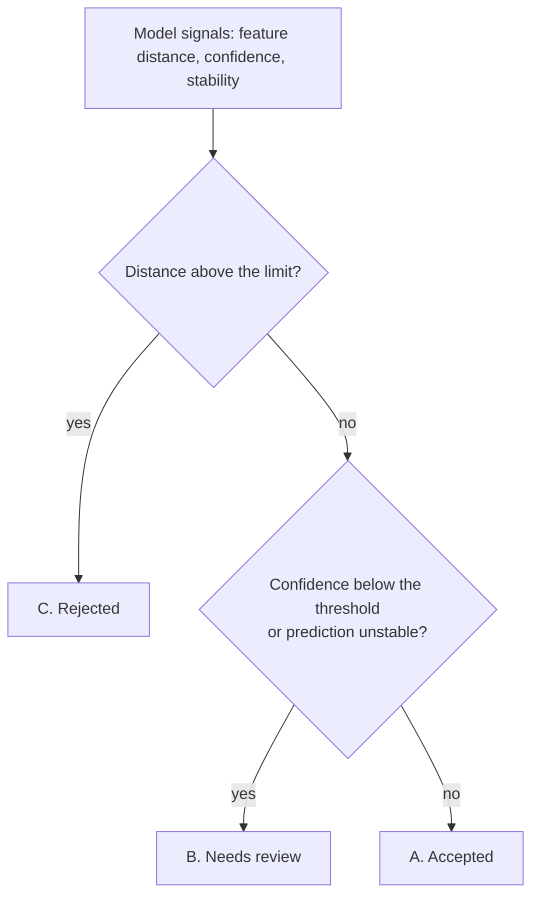
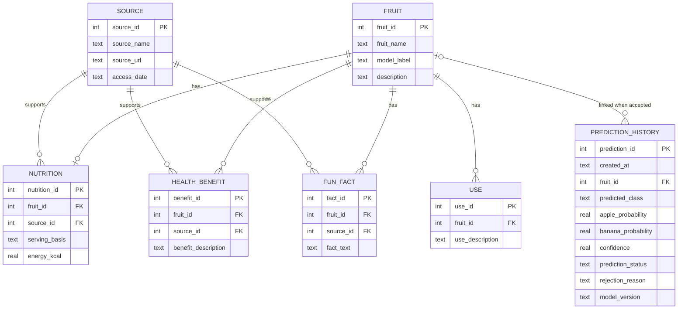

<!--
File: architecture.md
Project: Intelligent Fruit Classification and Information System
Description: Documents the system architecture, component
responsibilities, data flow, dependencies, and integration boundaries.
Author(s): Group 8
Responsible Area: Shared/Core
-->

# System Architecture

**Project:** Intelligent Fruit Classification and Information System (COMP6900, Group 8)

This document describes how the system is built: its components, how a request flows through them, how data is stored, how failures are handled, and why the main design decisions were taken. For installation and use, see the [README](../README.md). For the model and the data, see the [model card](model_card.md) and the [dataset card](dataset_card.md).

## 1. Purpose and Scope

The system lets a user upload a picture, decides whether it shows an **apple** or a **banana**, and, when the decision is trustworthy, shows information about that fruit from a database. Every attempt is recorded in a prediction history.

**In scope:** Apple versus Banana classification; judging whether a prediction can be trusted; fruit information (nutrition, health benefits, uses, fun facts, sources); prediction history.

**Out of scope:** ripeness, quality or freshness; any other fruit; user accounts; storing uploaded images; retraining the model inside the application. Model training and evaluation are performed offline in notebooks; the application only loads the finalised model.

## 2. System Overview

The work is divided into four areas of responsibility (the project's *pillars*), and the code follows the same boundaries.

| Pillar | Area | Main code |
|--------|------|-----------|
| 1 | Dataset and data engineering | Dataset preparation notebook; [dataset card](dataset_card.md) |
| 2 | Machine learning and evaluation | `src/preprocessing/`, `src/ml/`, `src/scripts/export_ood_stats.py`, training notebooks |
| 3 | Database and information system | `src/repositories/`, `src/database/`, `src/scripts/init_db.py` |
| 4 | Application and system integration | `app.py`, `src/ui/`, `src/services/` |



*Figure 1. Components and their dependencies. Arrows point from the caller to the callee.*

The dependency rule is simple: the pages call only the prediction service; the service calls the machine-learning modules and the repositories; the machine-learning modules and the repositories do not call each other. The three shared modules in `src/fruit_classifier/` (`config.py`, `schemas.py`, `exceptions.py`) are used by every layer and are the only place where constants, data structures and exception types are defined.

## 3. Components and Responsibilities

| Component | Responsibility |
|-----------|----------------|
| `app.py` | Entry point. Configures the page, loads the model once, shows a clear error and stops if the model cannot be loaded, and defines the three-page navigation. |
| `src/ui/home_page.py` | Home page: introduction, how it works, supported fruit, header picture. |
| `src/ui/classify_page.py` | Upload, preview, classification button, and the view for each outcome, including the fruit information sections. |
| `src/ui/history_page.py` | Summary tiles and a paginated table of past attempts, read from the database. |
| `src/ui/styles.py`, `src/ui/messages.py` | Shared styling and HTML builders (all text is escaped); all user-facing wording, so that messages stay consistent. |
| `src/services/prediction_service.py` | Orchestrates one classification: preprocess, predict, apply the policy, load fruit information for accepted predictions, save history. Separates outcomes from technical failures. Also reads the history. |
| `src/preprocessing/image_preprocessor.py` | Validates the uploaded file and prepares the image exactly as the model was trained (Section 6 of the notebook). |
| `src/ml/model_service.py` | Loads the trained network and the feature statistics once; returns class probabilities, feature distance and test-time stability for an image. |
| `src/ml/prediction_policy.py` | Turns those signals into one of the four outcomes (Section 5). |
| `src/repositories/database.py` | SQLite connections (foreign keys enabled). |
| `src/repositories/fruit_repository.py` | Reads a fruit and its nutrition, health benefits, uses, fun facts and sources. |
| `src/repositories/prediction_repository.py` | Writes and reads prediction history. |
| `src/database/schema.sql`, `seed_fruit.sql` | Table definitions and the agreed initial fruit information. |
| `src/scripts/init_db.py` | Creates the database from the two SQL files; refuses to overwrite an existing database unless `--reset` is given. |
| `src/scripts/export_ood_stats.py` | Rebuilds the feature statistics from the training embeddings and reports how candidate thresholds behave (see [artifacts/README.md](../artifacts/README.md)). |
| `src/fruit_classifier/` | Shared configuration, data structures (`PredictionResult`, `ClassificationResponse`, `FruitInformation`) and exceptions. |

## 4. Runtime Workflow



*Figure 2. Sequence of one classification.*

1. The user chooses a file; the page shows a preview. Nothing is classified or stored yet.
2. On pressing **Classify Image**, the page calls `PredictionService.classify` once. The result is kept in the session, so reruns of the page do not classify again or store a second history row.
3. The preprocessor validates and prepares the image. An unreadable or unsupported file stops here and becomes outcome D; the model is not run.
4. The model returns the probabilities and two reliability signals.
5. The policy assigns the outcome.
6. For an accepted prediction the service loads the fruit and its information from the database and links the history row to the fruit.
7. The attempt is saved, subject to the history policy (Section 7.3). The page then displays the outcome appropriate to the result.

## 5. Prediction Outcomes and Decision Policy

A classifier for two classes always answers *Apple* or *Banana*, even for a photograph of a landscape, and its confidence is not a reliable guard on its own. The application therefore separates three questions: *is this a readable supported image*, *does it resemble the images the model was trained on*, and *is the model sure*.

| Outcome | Meaning | Behaviour |
|---------|---------|-----------|
| A. Accepted | In-distribution, confident and stable | Show the fruit, both probabilities, the confidence and the database information |
| B. Needs review | Possibly valid, but not confident or not stable | Show a tentative prediction and probabilities with a warning; no fruit information; offer a retry |
| C. Rejected | Too unlike the known fruit images | Do not confirm a fruit and show no fruit information |
| D. Invalid input | The file cannot be read as a supported image | Show an error and a retry option; no probabilities, since the model never ran |



*Figure 3. The decision rule applied to a readable image. Outcome D arises earlier, in the preprocessor.*

The three signals are:

- **Confidence:** the highest class probability.
- **Feature distance:** the Mahalanobis distance from the image's 1,280 network features to the nearest class centroid, using one shared covariance (Lee et al., 2018). A large value means the image resembles none of the training images. It is an out-of-distribution signal, not proof that the image is not a fruit.
- **Stability:** whether the predicted class is unchanged when the image is flipped, rotated by ±10° and brightened.

The thresholds are defined in `src/fruit_classifier/config.py`. Their values, the evidence for them and the trade-offs between them are documented in the [model card](model_card.md) (Section 9). 

_The policy is deliberately a separate module, so that thresholds can be tuned and tested without touching the model or the interface._

## 6. Image Input Handling

The preprocessor accepts a file as bytes or as a file-like object and applies the same steps that produced the training data (`PP_v1`):

1. Check that the file is not empty and not larger than the limit (5 MB by default).
2. Identify the format from the **file content**, not the extension, and accept JPEG, MPO, PNG, WEBP, BMP, GIF, TIFF and (with the optional `pillow-heif` package) HEIC/HEIF. The extension only filters the file picker.
3. Decode (JPEG files with a reduced-size decode, as in training), apply the EXIF orientation, convert to RGB and resize to 128 × 128 with bicubic interpolation.

Content-based detection matters in practice; as phone and camera photographs are often MPO files (a JPEG variant). A check based on extensions, or on a short list of format names, would have rejected a perfectly good photograph. Animated GIF and WEBP files and multi-page TIFF files use their **first frame**.

Files that cannot be used produce a specific reason code, shown to the user in different words for each case: `empty_file`, `file_too_large`, `unreadable_file` (not an image, or corrupt) and `unsupported_format` (a valid image in a format outside the list).

## 7. Data architecture

### 7.1 Database

The database is SQLite (`src/database/fruit_classifier.db`, created locally by `init_db.py` and not committed to version control).



*Figure 4. Entity-relationship diagram (`NUTRITION` shows only its identifying columns; it also stores protein, carbohydrate, sugars, fibre, fat, potassium and vitamin C per 100 g).*

`FRUIT.model_label` (`apple`, `banana`) is the key that links the model's output to the database. Every nutrition, benefit and fact row points to a `SOURCE`, so each item shown to the user can be attributed (see [data_sources_and_licensing.md](data_sources_and_licensing.md)). Fruit information is loaded for accepted predictions only.

### 7.2 Prediction History

Each classification attempt is one row. `created_at` is filled in by SQLite (UTC) and displayed in the viewer's local time. The row stores metadata only: the uploaded image is never stored.

| Outcome | `fruit_id` | `predicted_class` | Probabilities and confidence | `rejection_reason` |
|---------|------------|-------------------|------------------------------|--------------------|
| Accepted | Fruit ID | Apple or Banana | Stored | Empty |
| Needs review | Empty | Tentative class | Stored | `low_confidence` or `inconsistent_under_transforms` |
| Rejected | Empty | Empty | Stored (for reference) | `far_from_training_data` |
| Invalid input | Empty | Empty | Empty | The file-problem code |

A `fruit_id` represents a *confirmed* fruit, so only accepted predictions receive one.

### 7.3 What is saved

All four outcomes are saved by default, subject to a successful database insert (`SAVE_TO_HISTORY_STATUSES` in `config.py`). Technical failures are never saved, because there is no prediction to record.

## 8. Error Handling

The system distinguishes **prediction outcomes**, which are normal results, from **technical failures**, which are faults. A fault is never presented as an ordinary classification outcome.

| Situation | Handling |
|-----------|----------|
| Unreadable or unsupported file | Outcome D, with a specific message; recorded in the history |
| Model files missing, inconsistent or corrupt | `ModelUnavailableError` at start-up. The application shows a clear error and stops; no prediction is attempted |
| The model fails on a readable image | `InferenceError`. The page shows a system error (not an outcome); nothing is saved |
| Fruit information cannot be loaded | The accepted prediction is still shown, with a warning that the information is unavailable (issue code `fruit_info_unavailable`) |
| History row cannot be saved | The prediction is still shown, with a warning that it was not saved (issue code `history_not_saved`) |
| History cannot be read | The History page shows an error that explains how to create the database |
| Database never initialised | `sqlite3` creates an empty file silently; the resulting "no such table" errors are caught and reported as the two cases above |
| Unrecognised result status | An explicit error, never a silent default |

The service reports non-fatal problems as codes in `ClassificationResponse.issues`, and the interface translates them into messages in one place (`src/ui/messages.py`).

## 9. Configuration

All tunable values are in `src/fruit_classifier/config.py`. Changes to this file affect every layer and should be reviewed by the team.

| Setting | Purpose |
|---------|---------|
| `CLASS_NAMES`, `IMAGE_SIZE`, `PREPROCESSING_VERSION` | The contract between the model and the application |
| `ALLOWED_IMAGE_FORMATS`, `UPLOAD_EXTENSIONS`, `MAX_UPLOAD_BYTES` | Which files are accepted |
| `CONFIDENCE_THRESHOLD`, `DISTANCE_REJECT_THRESHOLD` | The decision policy (Section 5) |
| `SAVE_TO_HISTORY_STATUSES` | Which outcomes are stored |
| `MODEL_CHECKPOINT_PATH`, `MODEL_SELECTION_PATH`, `OOD_STATS_PATH`, `ASSETS_DIR` | File locations |

The application reads no environment variables. The model, its statistics and the thresholds form one calibrated set (see [artifacts/README.md](../artifacts/README.md)).

## 10. User-Interface Design

The interface has the three agreed pages: Home, Classify Fruit and Prediction History. Fruit information is shown on the Classify page after an accepted prediction and is not a separate page. The needs-review outcome never shows fruit information, and the interface never states ripeness. Unsupported images (outcome C) and unreadable files (outcome D) use different messages. For a rejected image, the class probabilities are placed in a collapsed *Technical details* section, because showing "58% Banana" beside a rejection would suggest a fruit was identified.

## 11. Streamlit-specific Design Decisions

Streamlit re-executes the script on every interaction, and re-imports every project module whenever a source file changes. Three decisions follow.

1. **Cache only the model.** `app.py` caches the loaded network (a heavy object that returns plain values) but rebuilds the lightweight `PredictionService` on each run. A cached service would keep returning objects of the *old* copy of the project's classes after a file edit, so that, for example, `status is PredictionStatus.ACCEPTED` stopped being true and every result was displayed as invalid. This fault was observed and is covered by regression tests.
2. **Compare statuses by value.** The Classify page dispatches on the status string, and treats an unrecognised status as an error, for the same reason.
3. **Classify on click only.** The result is stored in the session and shown on later reruns, so only the button press classifies and saves a history row.

## 12. Security and Privacy

- Uploaded images are processed in memory and are never written to disk or to the database.
- The history stores prediction metadata only.
- All database text is HTML-escaped before display, and links are created only for `http` and `https` addresses.
- The checkpoint is loaded with `weights_only=True`, which refuses arbitrary code in the file.
- The network is built without downloading pretrained weights; the application makes no network request to classify an image.
- The history is shared by everyone who uses the same installation; there are no user accounts.
- Files are limited in size (5 MB) and checked by content before decoding.

## 13. Testing Strategy

The automated suite runs with `pytest` and does not need the trained model files (the model tests build a small randomly initialised network with the same architecture).

| Test file | What it verifies |
|-----------|------------------|
| `test_image_preprocessor.py` | Supported formats (including MPO and HEIC), EXIF orientation, rejection reasons, and that the output matches the training pipeline pixel for pixel |
| `test_model_service.py` | Architecture parity with the training notebook, loading and failure modes, signal calculation, database-safe types |
| `test_prediction_policy.py` | Every outcome, rule order and threshold boundaries |
| `test_prediction_service.py` | The workflow with a fake model and fake repositories: what is shown, what is saved and how each failure is reported |
| `test_prediction_service_integration.py` | The service against the real repositories and the real SQL files, using a temporary database |
| `test_ui_pages.py` | The pages, run headlessly with Streamlit's test harness, for every outcome, including recovery after Streamlit reloads modules |

The tests contain regression tests for each fault found during development, and the suite was run on Windows (Python 3.9) and Linux (Python 3.12).

## 14. Technology Stack and Decisions

| Component | Technology | Notes |
|-----------|------------|-------|
| Language | Python 3.9 or later | |
| Interface | Streamlit (1.37 or later) | Multi-page navigation, Python only |
| Model | PyTorch and torchvision (EfficientNetB0) | CPU inference |
| Image handling | Pillow (optional `pillow-heif`) | |
| Database | SQLite through Python's `sqlite3` module | Local file, no server |
| Evaluation and statistics | NumPy, pandas, scikit-learn, Matplotlib | Notebooks and `export_ood_stats.py` |
| Tests | pytest | |
| Version control | Git and GitHub | |

**Framework decision.** Early planning listed TensorFlow/Keras for the model. The final implementation uses PyTorch and torchvision, and does not depend on TensorFlow.

**Policy decision.** A single confidence threshold was rejected as insufficient (Section 5); the three-signal policy and the separation of outcomes from failures were agreed as the central design of the system.

## 15. Known Limitations and Future Work

| Limitation | Possible improvement |
|------------|----------------------|
| Only two classes; other fruit can be classified confidently as apple or banana | Add more classes, or an explicit "other" class trained on unsupported images |
| A single distance limit rejects some valid but unusual photographs (for example a pile of apples) and accepts some unsupported ones | Allow a larger distance for confident, stable predictions; raise the confidence threshold; evaluate on a fresh unsupported set (see the model card) |
| Test accuracy may be optimistic if variants of a photograph lie in different splits | Group photographs with their variants before splitting and re-evaluate |
| Thresholds depend on one checkpoint | Re-run the calibration script whenever the model changes |
| History is not per user and holds no images or per-user data | Add accounts and optional image thumbnails only after a privacy decision |
| No ripeness or quality assessment | Out of scope; would need new data and a new model |

## 16. Repository Structure

```text
Intelligent_Fruit_Classification_and_Information_System/
├── app.py                          Streamlit entry point
├── requirements.txt
├── README.md
├── .gitignore
├── artifacts/                      Model files (see artifacts/README.md)
├── data/                           Dataset metadata (images are not needed to run the app)
├── docs/                           architecture, model card, dataset card, licensing
├── notebooks/                      Dataset preparation, training and collation notebooks
├── src/
|   ├── assets/                     Home page header picture
│   ├── fruit_classifier/           config.py, schemas.py, exceptions.py
│   ├── preprocessing/              image_preprocessor.py
│   ├── ml/                         model_service.py, prediction_policy.py
│   ├── services/                   prediction_service.py
│   ├── repositories/               database.py, fruit_repository.py, prediction_repository.py
│   ├── database/                   schema.sql, seed_fruit.sql
│   ├── scripts/                    init_db.py, export_ood_stats.py
│   └── ui/                         home_page.py, classify_page.py, history_page.py, styles.py, messages.py
└── tests/                          pytest suite
```

## 17. References

Lee, K., Lee, K., Lee, H. and Shin, J. (2018). A simple unified framework for detecting out-of-distribution samples and adversarial attacks. *Advances in Neural Information Processing Systems (NeurIPS)*.
